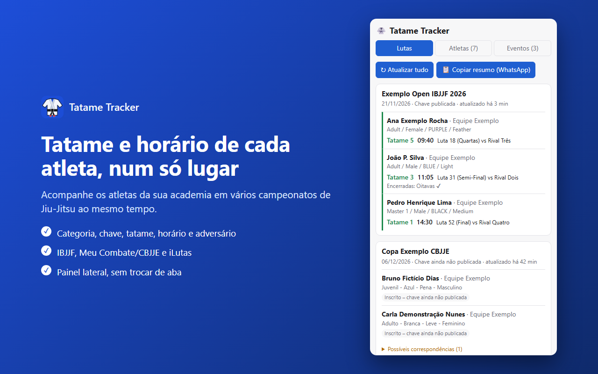

# 🥋 Tatame Tracker

[](https://github.com/guiBiagini/tatame-tracker/actions/workflows/ci.yml)
[](LICENSE)
<!-- Depois da aprovação, adicionar o selo/link da Chrome Web Store aqui. -->

Extensão de navegador que centraliza **categoria, horário e tatame** dos atletas da sua academia em campeonatos de Jiu-Jitsu. Ela substitui a busca manual, atleta por atleta, nos sites de cada federação.

- Cadastre os atletas uma vez (inclusive em lote).
- Cole o link do campeonato: a extensão identifica a plataforma sozinha.
- Veja num painel lateral quem está inscrito, em qual categoria e, quando a organização publicar, **tatame, horário, número da luta e adversário**.
- Receba **notificações** quando a chave sair ou quando o tatame ou horário mudar.
- **Copie um resumo** pronto para o grupo da academia no WhatsApp.



## Plataformas suportadas

| Plataforma | Federações / exemplos | Dados | Como integra |
|---|---|---|---|
| **IBJJF** (bjjcompsystem.com ou link do ibjjf.com) | IBJJF, CBJJ | Inscritos, chave, **tatame, horário, luta, adversário, resultado** | HTML do servidor |
| **Meu Combate** | CBJJE (eventocbjje.com.br) e outras do mesmo sistema | Inscritos, chave, **área, horário previsto, luta, adversário e resultado** | API JSON pública |
| **iLutas** | CBJJC, FMAS/PFBJJ, FCJJE, FEJJES, FJJCE… | Inscritos, chave (fase, adversário, tamanho) e **previsão de horário** pelo cronograma. A plataforma não publica tatame | HTML do servidor |

Planejadas: PDFs do Google Drive (BJJ Storm, Genesis Esportes), Smoothcomp (via leitura da página aberta pelo usuário) e FJJEMG/LMJJ.

## Chave e cronograma publicados perto da data

Muitas organizações só publicam a chave e o cronograma poucos dias antes do evento. A extensão trata isso como parte normal do ciclo:

```
inscrito → chave publicada → luta agendada (tatame/horário) → encerrada
```

A frequência de consulta se adapta à data do evento:

| Quando | Frequência |
|---|---|
| Mais de 7 dias antes | 1× por dia |
| 2 a 7 dias antes | a cada 3 h |
| Véspera | a cada 1 h |
| Dia do evento | a cada 5 min (IBJJF e Meu Combate) / 1 h (iLutas) |
| Dia seguinte | a cada 6 h (resultados) |
| Depois disso | para de consultar |

### Particularidades do iLutas

- **Previsão, não horário marcado:** o cronograma do iLutas é uma tabela escrita pelo organizador, com um horário por grupo ("15:00 FAIXA AZUL – ADULTO E MASTER"). A extensão compara a categoria do atleta (kimono ou sem kimono, absoluto, divisão de idade, faixa) com essas linhas e mostra **"Previsão ~15:00"** junto da linha usada. Se nenhuma linha for clara, ou se houver empate, não mostra previsão.
- **A lista de inscritos sai do ar no dia do evento.** A extensão guarda o que encontrou nas consultas anteriores e continua pelas chaves. Por isso, **adicione o evento antes do dia**. Se ele for adicionado só no dia, a extensão lê todas as chaves (≈250 páginas, cerca de 1,5 min), no máximo a cada 6 h. Os nomes da chave são curtos, então os atletas aparecem como "possíveis correspondências" para confirmar.

## Arquitetura

```
src/
├── core/          # Lógica pura em TypeScript, sem dependência do navegador (roda em Node/backend)
│   ├── model.ts       # Modelo normalizado: Athlete, TrackedEvent, Entry, Fight, EventSnapshot
│   ├── adapter.ts     # Contrato ProviderAdapter + Http injetável
│   ├── names.ts       # Comparação de nomes (acentos, partículas, abreviações, equipe)
│   ├── sync.ts        # Orquestra: busca evento → cruza atletas → busca lutas → snapshot
│   ├── schedule.ts    # Frequência de atualização por proximidade do evento
│   ├── diff.ts        # Mudanças entre consultas → notificações
│   └── summary.ts     # Texto para WhatsApp
├── adapters/      # Um adaptador por PLATAFORMA (não por federação)
│   ├── ibjjf.ts
│   ├── meucombate.ts
│   ├── ilutas.ts
│   └── index.ts       # Registro + detecção pela URL
├── lib/           # Integração com a extensão (storage, execução, mensagens)
└── entrypoints/
    ├── background.ts  # Alarme a cada 5 min, sincronização e notificações
    └── sidepanel/     # Interface (React)
```

**Para adicionar uma plataforma:** crie `src/adapters/<nome>.ts` implementando `ProviderAdapter` (`parseUrl`, `fetchEvent` e, se a plataforma publicar tatame e horário, `fetchFights`). Depois registre o adaptador em `src/adapters/index.ts`, adicione o host em `host_permissions` no `wxt.config.ts` e escreva um teste com fixture.

## Desenvolvimento

Requisitos: Node.js 20+.

```bash
npm install
npm test          # testes (Vitest)
npm run compile   # checagem de tipos
npm run dev       # abre o Chrome com a extensão carregada e hot reload
npm run build     # gera .output/chrome-mv3
npm run demo      # abre a interface do painel em http://localhost:5199, sem instalar a extensão
bash scripts/store-shots.sh   # com a demo rodando: regera as imagens da Chrome Web Store em docs/store/
node scripts/build-icons.mjs  # regera public/icon/*.png a partir de assets/brand/*.svg (requer @resvg/resvg-js)
```

A **demonstração** (`demo/`) usa a mesma interface e a mesma sincronização da extensão. Só o armazenamento do Chrome é trocado pelo `localStorage` da página. O evento da CBJJE é consultado de verdade; o evento IBJJF da demo é fictício e serve para mostrar tatame e horário. Em `demo/store/` fica a vitrine (100% fictícia) usada para gerar as capturas da loja.

### Instalar no Chrome sem a loja

1. `npm run build`
2. Abra `chrome://extensions` e ative o **Modo do desenvolvedor**.
3. Clique em **Carregar sem compactação** e selecione `.output/chrome-mv3`.
4. Clique no ícone da extensão para abrir o painel lateral.

## Princípios

- **Respeito aos sites:** só lê páginas públicas, consulta pouco quando o evento está longe, espaça as requisições e guarda cache local. Não contorna proteções anti-bot (Cloudflare, captcha) nem faz login no lugar do usuário.
- **Privacidade:** tudo fica no navegador do usuário (`chrome.storage.local`), sem servidor. Veja a [Política de Privacidade](PRIVACY.md). As fixtures de teste usam **nomes fictícios**: nenhum dado real de atleta vai para o repositório.
- **Falha visível:** se um site mudar de estrutura, o evento mostra o erro e mantém os últimos dados conhecidos, em vez de exibir informação errada.

## Contribua

O Tatame Tracker é **open-source e colaborativo**: qualquer pessoa da comunidade do Jiu-Jitsu pode ajudar a melhorar o código atual.

- **Encontrou um erro** ou um site que mudou de estrutura? Abra uma [issue](https://github.com/guiBiagini/tatame-tracker/issues) com o link do evento.
- **Quer suportar uma nova federação ou plataforma?** Siga o passo a passo em [Arquitetura](#arquitetura) e envie um pull request.
- Antes de enviar, rode `npm test` e `npm run compile`. Nas fixtures de teste, use sempre **nomes fictícios**.

O passo a passo completo, a estrutura de pastas e as regras de privacidade estão no **[guia de contribuição](CONTRIBUTING.md)**. As mudanças de cada versão ficam no [CHANGELOG](CHANGELOG.md).

## Licença

Distribuído sob a **[GNU GPL v3.0 ou posterior](LICENSE)**. Você pode usar, estudar, modificar e redistribuir a extensão livremente, inclusive publicar a sua versão. A condição é que **versões modificadas que forem distribuídas também sejam GPL**, com o código aberto. Assim, as melhorias voltam para a comunidade e o projeto não pode ser fechado e revendido.

Ao enviar uma contribuição, você concorda que ela seja distribuída sob a mesma licença.

## ☕ Apoie o projeto (Buy Me a Coffee)

Se a extensão ajuda você ou a sua academia, considere pagar um café para apoiar o desenvolvimento:

**Pix (chave aleatória):**

```
7c71d3fc-606c-43d4-a704-63720335cb17
```

Toda contribuição, seja em código ou em café, é muito bem-vinda. Oss! 🥋
